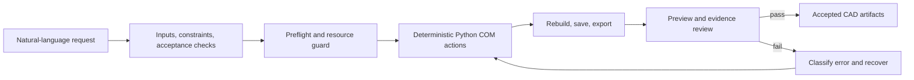

# SolidWorks Agentic Automation

[简体中文](README.zh-CN.md) | English

An open, reusable pattern for letting an LLM or coding agent operate SolidWorks through
Python COM. The repository combines deterministic CAD helpers with a guarded agent loop:
preflight, resource control, modeling, real assembly mates, export, visual review,
failure recovery, and structured evidence.

This is deliberately not a collection of one-off model generators. Domain-specific
dimensions, proprietary CAD, simulation data, and private prompts are outside the core.
The reusable pattern is the product: an agent turns an intent contract into guarded,
deterministic CAD actions, then refuses to call the result complete until the artifact
and its evidence pass review.

## What it provides

- Part sketch and feature helpers
- Assembly components and checked `AddMate5` mates
- Drawing and common neutral-format export
- Multi-view preview generation and machine-readable review reports
- Single-heavyweight-session guard for SolidWorks/ANSYS workflows
- Atomic event and evidence JSON for reproducible agent runs
- A workflow state machine that prevents "saved successfully" from meaning "done"
- COM troubleshooting and migration guidance for Codex, Claude, OpenClaw, and other agents

## Architecture



## Requirements

- Windows 10/11
- SolidWorks installed and launched at least once
- Python 3.9+
- `pywin32` and `comtypes`

```powershell
python -m pip install -r requirements.txt
python scripts/sw_preflight.py --no-install
python scripts/validate_skill.py
```

## Install as an agent skill

Clone the repository into a skill directory used by your agent, for example:

```powershell
git clone https://github.com/WilliamDee-Huang/solidworks-agentic-automation.git
cd solidworks-agentic-automation
```

```text
%USERPROFILE%\.codex\skills\solidworks-agentic-automation\
%USERPROFILE%\.agents\skills\solidworks-agentic-automation\
%USERPROFILE%\.openclaw\skills\solidworks-agentic-automation\
```

The root `SKILL.md` is the agent entry point. Scripts can also be imported directly:

```python
import sys
sys.path.insert(0, r"<LOCAL_PATH>")

from sw_connect import mm
from sw_session import SolidWorksSession
```

### Local execution is required

This repository is an instruction and automation package, not a remote-control service.
The agent must run on the same Windows machine and interactive desktop session as
SolidWorks, with a real shell, Python, filesystem access, and COM access. Uploading the
repository to a web chat or adding it as knowledge does not grant access to the user's
drives or SolidWorks installation.

If the agent cannot run `python scripts/sw_preflight.py --no-install`, it must stop and
say that it can only provide instructions or source code. It must not claim that ZIP,
CAD, preview, or export files were created or attached. A completed delivery must include
the verified absolute path, file size, and modification time for every required artifact.

See the [part workflow](examples/agent_loop/build_mounting_plate.py), the
[real-mate assembly workflow](examples/agent_loop/build_mated_assembly.py), and
[the migration guide](docs/migration-guide.md).
For a new mechanical domain, start with the [domain adapter guide](docs/domain-adapters.md)
and copy the [adapter template](templates/domain-adapter/).

## The transferable pattern

The reusable unit is the contract-and-review loop, not a particular feature tree:

1. Describe intent, confirmed inputs, unknowns, invariants, and acceptance checks.
2. Let the agent plan, while a deterministic adapter performs COM operations.
3. Rebuild, save, export, preview, and record evidence after each meaningful stage.
4. Recover from classified failures with bounded, single-variable retries.
5. Accept the result only when artifact checks and visual review agree.

This lets the same Skill be adapted to mounting plates, bearing housings, fixtures,
robot links, gears, enclosures, and other mechanical parts. The domain adapter changes;
the resource guard, session lifecycle, COM error discipline, evidence model, and review
gate remain reusable.

## Safety and reproducibility

The resource guard never kills an existing process. It blocks conflicting launches and
expects the agent or user to decide whether an active session belongs to the current job.
The workflow edits a working copy by default and keeps native CAD, exports, previews, and
evidence separate.

## Scope

SolidWorks Simulation and external CAE products are not abstracted as stable public APIs
here. The repository supports controlled CAD handoff and evidence collection; simulation
automation should live in a separate adapter with its own material, contact, mesh, load,
license, and solver validation.

## Public/private boundary

The public repository contains generic helpers, examples, tests, and anonymized
workflow rules. Keep customer or laboratory artifacts in a separate private adapter:

- native `.SLDPRT`, `.SLDASM`, and `.SLDDRW` files;
- ANSYS/SolidWorks Simulation projects and result files;
- experiment data, loads, material allowables, and unpublished dimensions;
- personal paths, credentials, license configuration, and screenshots.

The publication hygiene test is intentionally conservative. Run it before publishing a
domain adapter or opening a pull request.

The repository is public, but a project adapter may remain private. Publish the generic
core and anonymized examples; keep project CAD and CAE workspaces in a separate private
repository or local directory.

## Provenance

The initial COM helper modules were derived from the MIT-licensed
[`wzyn20051216/solidworks-automation-skill`](https://github.com/wzyn20051216/solidworks-automation-skill).
This repository adds and reorganizes the agent loop, resource guard, evidence model,
assembly acceptance rules, recovery playbook, tests, and generic examples. See `NOTICE`.

## License

MIT. SolidWorks is a trademark of Dassault Systemes SolidWorks Corporation. This project
is independent and is not affiliated with or endorsed by Dassault Systemes.
