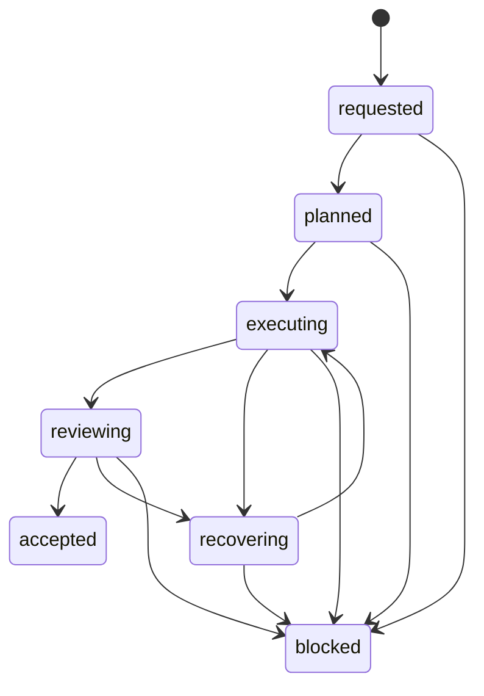

# Agent Loop

## States



`accepted` is terminal. Saving a file is an event inside `executing`; it is not an
acceptance state.

## Request contract

Record the following before execution:

```json
{
  "source": {"path": null, "modify_in_place": false},
  "inputs": {"units": "mm", "dimensions": {}},
  "constraints": {"interfaces": [], "invariants": []},
  "unknowns": [],
  "outputs": ["native-cad", "step", "review-report"],
  "acceptance": ["rebuild-clean", "expected-body-count", "visual-review"]
}
```

Unknowns remain `null`. An agent may propose a bounded assumption only when the request
allows it, and must record the assumption separately from confirmed data.

## Recovery policy

1. Capture the failing call, inputs, error code, selected count, active document, and
   relevant process/dialog state.
2. Classify the failure.
3. Return to the earliest uncertain stage.
4. Change one variable.
5. Retry a bounded number of times.
6. Preserve the last valid native model and evidence.
7. Block with a precise reason when progress requires user input or a license/tool change.

Repeatedly launching a new SolidWorks process is not a recovery strategy.

## Review policy

Automatic checks catch missing files, blank previews, suspicious file sizes, and explicit
COM failures. They cannot establish that the geometry matches the user's mental model.
The final review therefore includes at least one human or vision-model inspection of the
exact native/STEP artifact used downstream.
