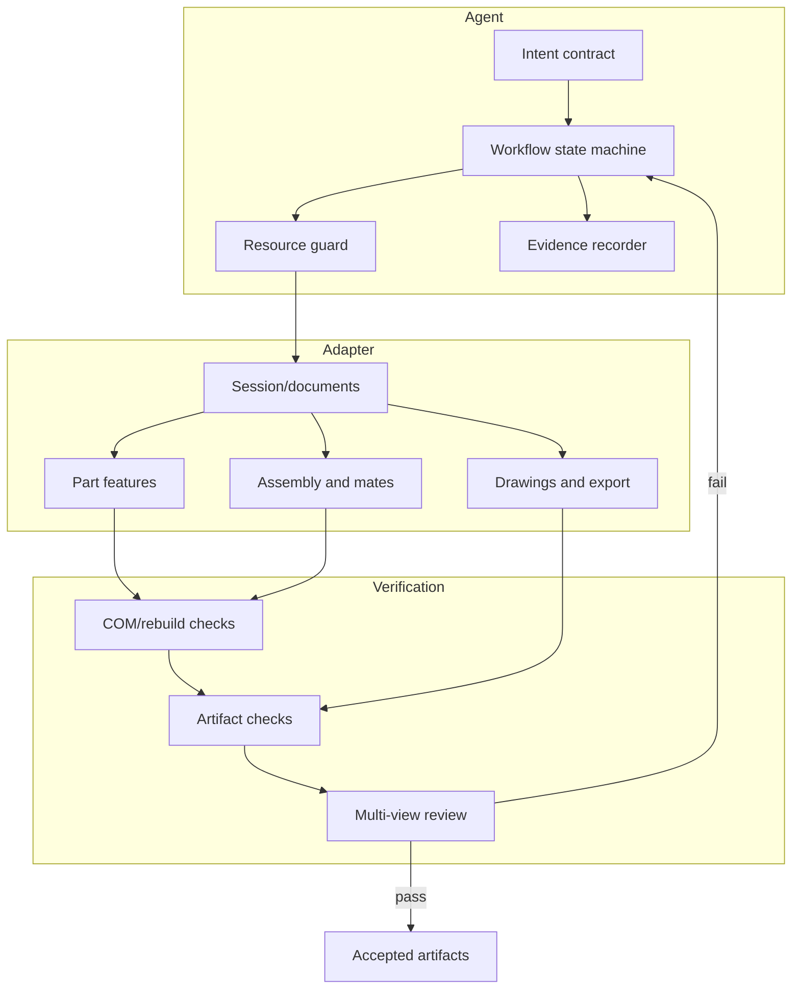

# Architecture

The project separates probabilistic planning from deterministic CAD execution.

## Layers

1. **Intent contract**: inputs, constraints, unknowns, outputs, and acceptance checks.
2. **Agent control**: workflow state, resource guard, bounded recovery, and evidence.
3. **SolidWorks adapter**: focused Python COM helpers for documents, parts, assemblies,
   drawings, exports, and previews.
4. **Verification**: return values, rebuild state, file metadata, body/component checks,
   mates, interference, and visual previews.
5. **Domain extension**: project-specific generators and CAE adapters kept outside the
   reusable core.

## Why scripts remain small

SolidWorks COM is version-sensitive, localization-sensitive, and unforgiving of incorrect
selection state. The modules intentionally expose focused functions instead of hiding the
entire API behind a large object model. Unwrapped operations should first be proven in a
minimal script, then promoted into the shared adapter after real execution and review.

## Extension boundary

A domain package may add parameter schemas, geometry generators, material libraries, or
CAE handoff. It should import this core rather than adding project constraints to
`SKILL.md`. Domain evidence may reference the generic run ID, but private CAD and solver
results should remain in the domain workspace.
